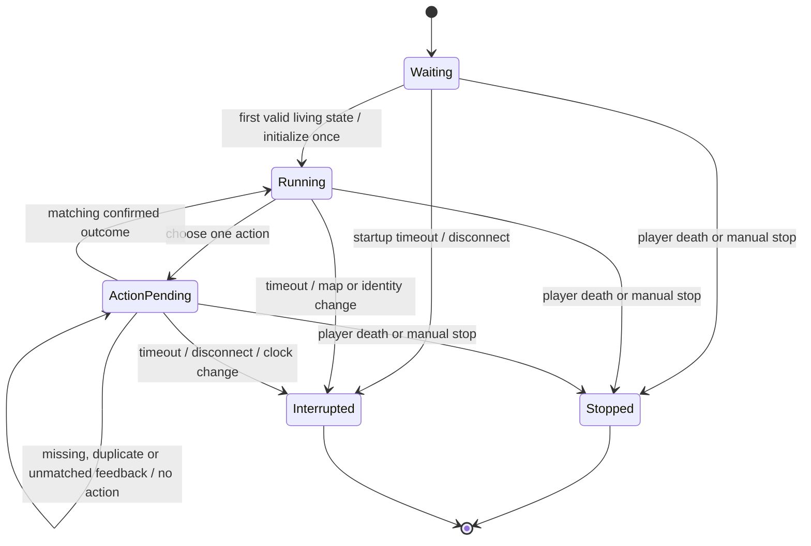

# Phase 8B: action history and a single live run

**Review 2026-10-22:** This is local implementation status, not verified live-server compatibility. See the [compatibility audit](LIVE_COMPATIBILITY_REVIEW.md) for reproduced blockers and required corrections.

Implemented: a separate single-run controller, a REP server, and opt-in bridge
support for connection identity, disconnect notification and terminal latching.
The deployment checkpoint remains unselected. The runnable server is deliberately
**observation only**: it exercises the lifecycle against the real payload without
issuing gameplay commands. A frozen actor can be supplied through the tested
Python interface. [Phase 8C](PHASE_8C.md) now supplies the matching live encoder,
telemetry specification and capture audit. Authoritative game/extension feedback wiring
and Phase 8F checkpoint loading remain outstanding. No random/scripted actor is
exposed as a live CLI policy.

## Run observation-only mode

Start the new backend first, in one terminal:

```powershell
.\RL_venv\Scripts\python.exe -m Inference.Mystic_Live.server --observe-only
```

In another terminal, start the matching bridge:

```powershell
.\RL_venv\Scripts\python.exe -m Automation.Bridge.ws_zmq_bridge --single-run
```

Use the existing JavaScript plugin to publish states. Do not run another backend
on port 5555 or another bridge on port 8765. The controller starts from the first
valid living-player map53 snapshot, without resetting or teleporting the game.
Observation-only replies always contain `move: null` and `reset: false`; the
inspected plugin parses null as no action. No new slot/action ID is introduced.

On death or interruption, the controller ends once and briefly drains pending
REP requests with inert replies (one second by default), then exits. The bridge
retains terminal status and answers later browser ticks locally with no action.
Later alive-player ticks, respawns, reconnects or a new backend process cannot
restart that run. Another explicit launch requires restarting both processes.
Ctrl+C in the backend is a manual stop. Simulation task goals, Y penalties and
step caps do not end live inference; unsupported maps still interrupt it.

The backend writes a new `runs/mystic_live/run_<UTC>_<id>/final_state.json` on exit.
Set `--snapshot-output PATH` for another new file. This retains the last current
state, exact previous state used for the last choice, distribution when provided,
confirmed history, unresolved pending action, bounded event feed and timing
report. It never overwrites an existing file. Live Pygame display remains later
integration; retaining this detached frame does not launch a second simulator.

Optional `--startup-timeout`, `--idle-timeout`, and `--acknowledgement-timeout`
default to 30, 2 and 2 seconds. `--drain-seconds` controls a short terminal drain
up to five seconds. Timeouts are explicit interruption conditions, not episode
resets or simulator step limits. Slow actor computation is checked again before
dispatch so an action cannot be sent after the run deadline.

The bridge's `--single-run` mode is opt-in; its ordinary legacy forwarding and
Phase 8A capture behavior remain available without this flag. Single-run mode
rejects legacy/malformed backend responses, reset requests, request-ID mismatches,
and changing backend run IDs. Its capture annotation order defaults to sim-seven
because that mode explicitly uses the seven-action contract. Optional evidence
capture can be combined with it:

```powershell
.\RL_venv\Scripts\python.exe -m Automation.Bridge.ws_zmq_bridge --single-run --capture runs/mystic_live/captures/observe_01.jsonl --capture-actions sim-seven
```

## Lifecycle



Terminal states are irreversible for a `SingleRun` instance. Repeated terminal
requests return inert replies and do not modify the retained final frame. Foreign
connections/runs, duplicate request IDs and stale client snapshots do not advance
actor memory or apply history. A player identity change interrupts the owned run.
Death stops before actor initialization/selection, including a fresh death state
already teleported to a death map. A pending action at stop stays unresolved,
not converted to a failed or successful action and never retried.

## Action/history correlation

The controller calls `actor.initial_state()` once and
`actor.choose(world_state, history, memory)` once per eligible decision. The hook
returns `PolicyChoice(action, next_memory, probabilities=None)` using the shared
seven-action IDs. Data passed for inspection is detached; drawing/reading a
snapshot never calls the actor or advances memory. The controller has no optimizer,
reward, rollout buffer, GAE, critic or reset call.

With Phase 8C's explicit `input_adapter`, the first argument is instead the raw
float32 56/80-vector. The CLI defaults to `--input-size 56`; requesting 80 also
requires an authoritative observation clock bound to the resulting snapshot.

Each selected command gets a unique `actionId` scoped to `runId`, and retains its
causing `requestId` and input state. While that action is pending, further ticks
receive inert replies. A matching confirmed outcome applies once before the next
decision; changing coordinates or MP is not execution confirmation.

This phase defines/validates the following **new execution-feedback contract**.
The existing JavaScript payload does not emit it. Phase 8C implements the feature
integration and telemetry validation, but the authoritative game-server producer
and extension forwarding remain outstanding. Synthetic tests validate the
Python consumer, not actual game acknowledgement semantics.

```json
{
  "execution": {
    "schema": "mystic_live_execution_v1",
    "runId": "run ID from the selected command",
    "actionId": "action ID from the selected command",
    "requestId": "request ID that caused that command",
    "actionLabel": "castSpell:1",
    "applied": true,
    "movementBlocked": false,
    "cooldownRejected": false,
    "clockId": "one consistent authoritative execution clock",
    "attemptedAtMs": 1000,
    "stateTimeMs": 1175
  }
}
```

The producer must attach the outcome to the corresponding resulting snapshot.
`attemptedAtMs` and `stateTimeMs` use the same identified execution clock, not the
client timestamp or Python `serverTime`. IDs, label, booleans and time ordering
must match. Duplicate, foreign, unmatched or stale outcomes do not apply. A
changed execution clock interrupts the run. Missing feedback times out rather
than allowing another command against invented history.

Successful-cast ages use confirmed absolute cast times, capped at ten seconds.
Rejected casts do not reset them. Unseen casts have an explicit seen flag and
unknown age; before the first acknowledgement, applied/blocked/rejected facts
are unknown. This fact ledger remains distinct from the Phase 8C 80-value encoder,
which reuses training's explicit episode reset and advancing unseen-age channels
alongside their zero seen flags. It never fills missing outcomes with zero history.

## Transport identity and timing

In single-run mode the bridge adds `bridgeContext` with schema
`mystic_single_run_bridge_v1`, a process `bridgeId`, WebSocket `connectionId`, and
bridge receive clocks. It overwrites client-supplied context. It forwards an
owner disconnect as a `bridge_event` through the same serialized REQ/REP stream.
The first backend run ID is pinned; later requests carry that ID. A foreign
connection cannot take over, and a backend restart cannot silently start again.
No JavaScript or game-server files are modified by this phase.

Timing reports distinguish client snapshot intervals, bridge receive intervals,
bridge queue age, acknowledgement latency and confirmed execution intervals.
They report observed values instead of substituting 200 ms. The simulator's
200 ms decision size is a comparison reference, not a claim of live cadence.
Real confirmed timing evidence is still needed before choosing scheduling changes
or simulator robustness training. File output is optional for Phase 8A capture
and occurs once at shutdown for the final lifecycle report, not every tick.

## Validation

```powershell
.\RL_venv\Scripts\python.exe -m unittest Tests.test_mystic_live_lifecycle Tests.test_mystic_live_evidence
```

Synthetic fixtures and local WebSocket/ZMQ tests cover readiness, exact-once
history, variable intervals, rejected casts, invalid/duplicate/stale/cross-run
messages, death, map changes, timeout, disconnect, manual stop, slow/failing
actors and frozen final frames. Bridge tests exercise reconnect and backend-run
changes and confirm that legacy reset replies become inert in single-run mode.
`Tests/fixtures/live/phase8b_sequence.json` is an explicitly synthetic saved trace.
No trained checkpoint or real game action is used in these tests. Actual loaded
extension/game identity and real authoritative feedback remain unverified.
