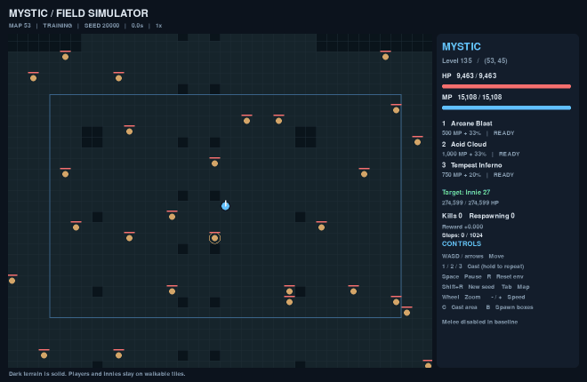
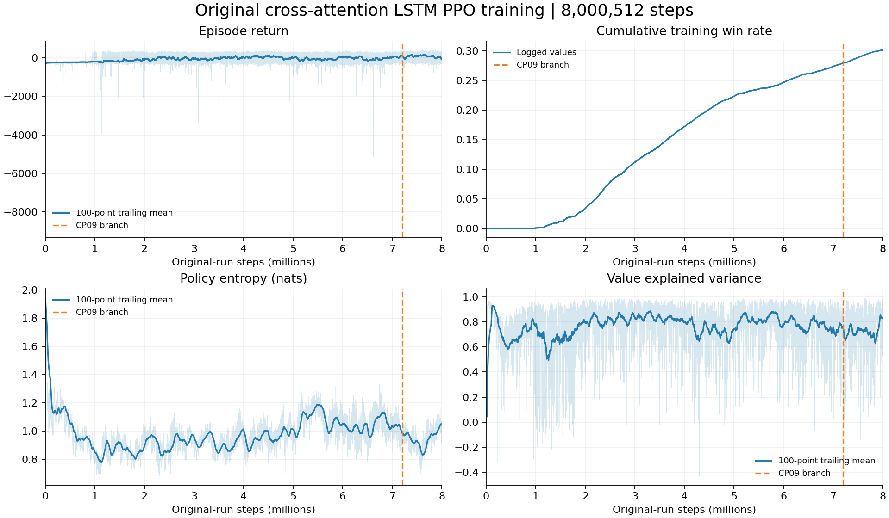
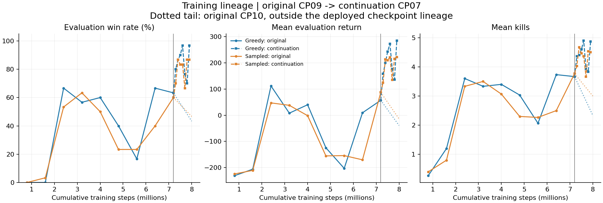

# RL Decision Server

This project trains reinforcement learning policies in a headless Yugen Saga
simulator and deploys trained checkpoints to the live game through a
WebSocket-to-ZMQ bridge. The current Mystic policy uses cross-attention,
LSTM memory and Proximal Policy Optimization (PPO).

## Mystic CP07: simulator policy running live

The Mystic CP07 checkpoint has been deployed successfully on live Yugen Saga
servers. The clips below show the simulator-trained policy controlling movement
and spell casting in the game. During deployment, the actor processes live
observations and maintains recurrent memory while its trained weights remain fixed.

### Live gameplay clips

The 70.7-second live gameplay recording is split chronologically into eight
looping GIFs (480 px wide, 6 fps, each under 3 MB). They cover the complete video;
the original MP4 remains local at `runs/rl yugen.mp4`.

| 0-9 seconds | 9-18 seconds |
| --- | --- |
|  |  |

<details>
<summary>More live clips: 18-70.7 seconds</summary>

| 18-27 seconds | 27-36 seconds |
| --- | --- |
|  |  |

| 36-45 seconds | 45-54 seconds |
| --- | --- |
|  |  |

| 54-63 seconds | 63-70.7 seconds |
| --- | --- |
|  |  |

</details>

The clips demonstrate live execution of CP07. Quantitative results below come
from separate simulator evaluations; no aggregate live win rate is recorded.
### Current algorithm: cross-attention LSTM PPO

The current Mystic model is recurrent **Proximal Policy Optimization (PPO)**,
trained in the headless simulator. Its 80-value observation contains player
state, up to ten enemies, local enemy offsets, action history and terrain sensors.
A multi-head attention (MHA) cross-attention encoder uses the player as a query over enemy keys
and values, masking empty/dead enemy slots. Its 64-value enemy summary is combined
with player, history and terrain features, then passed through a feedforward
encoder and a 128-unit LSTM to retain context across decisions.

Actor and critic have separate encoders and recurrent states. PPO trains the
actor with a clipped policy objective and the critic to predict returns. The
actor outputs seven action probabilities: four movement directions and three
spells. Deployment loads only the frozen actor's decision path and carries its
LSTM memory between live snapshots; sampled or greedy selection determines the
action sent through the existing bridge. See the [attention encoder](Training/Mystic_Sim/Attention.py),
[recurrent model](Training/Mystic_Sim/recurrent.py), and [training loop](Training/Mystic_Sim/train.py).

### Play and watch the headless simulator

The Mystic simulator is a headless implementation of the configured map53 game
rules. Training and evaluation advance the world without a browser, game server,
or display. The optional Pygame viewers render that same environment: opening a
window does not replace its movement, combat, cooldown, regeneration or NPC logic.
The goal is one-to-one correspondence with the configured game mechanics; live
deployment uses this parity assumption for history that the browser does not report.

The following GIFs are CP07's saved simulator evaluation recordings on seed 20000.
They show the same checkpoint used in the live demonstration above, with greedy
and sampled action selection. Each file is under 2.5 MB. These are simulator
renders, not live-game captures or recordings of the newer inspector dashboard.

| CP07: greedy simulator playback | CP07: sampled simulator playback |
| --- | --- |
|  |  |

Source recordings are `gameplay/checkpoint_07.gif` and
`gameplay/checkpoint_07_sampled.gif` in the continuation run directory. They are
rendered at the saved recording stride, so they omit intermediate decision frames.

#### Play manually

Install the optional viewer dependencies once, then launch from the repository root:

```powershell
.\RL_venv\Scripts\python.exe -m pip install -r requirements-viewer.txt
.\Play_Mystic_Sim.bat --seed 42
```

The window starts paused. Press Space to begin. WASD or the arrow keys move the
player; 1, 2 and 3 cast Arcane Blast, Acid Cloud and Tempest Inferno. Targets are
selected automatically. One action executes per 200 ms decision, with held
spell keys taking priority over movement.

| Control | Manual player and policy viewer |
| --- | --- |
| Space | Pause or resume |
| R | Reset the world and replay the same seed |
| Shift+R | Reset with the next seed |
| Tab / mouse wheel | Map overview / camera zoom |
| - / + | Decrease / increase playback speed |
| C / B | Show casting range / spawn boxes |
| Escape | Close the viewer |

Manual play defaults to the training rules: five kills or the 1,024-step limit
ends the episode. Use `.\Play_Mystic_Sim.bat --free-play --seed 42` for exploration
with those limits overridden. Death and the configured Y-boundary failure still
end free play. See the [manual viewer guide](Custom_enviornments/Mystic_Sim/README.md#play-the-simulator-with-pygame)
for reset behavior, colors and timing.

#### Watch a trained checkpoint

```powershell
$Checkpoint = "runs\mystic_sim\full\attention_cp09_continue_1m_lr1e4_seed42\checkpoints\checkpoint_07.pt"
.\Watch_Mystic_Policy.bat --checkpoint $Checkpoint --seed 20000 --mode sampled --device cpu
```

Use `--mode greedy` to watch highest-probability actions, or `--device cuda` for
GPU inference. The watcher defaults to sampled mode on CPU. It loads the
checkpoint's saved scenario and normalization, keeps its weights fixed, and
resets LSTM memory and observation history when an episode is reset.

Press Space to run, or **N** to advance one policy decision while paused. Manual
movement and spell inputs are disabled in this viewer. The dashboard displays
all seven action probabilities and provides Summary, Player, Enemies, History
and Inputs tabs. **Previous state** shows the observation that produced the
last decision; **Current state** shows the resulting world. Rendering, pausing
and inspecting tabs do not advance the policy's memory or simulation clock.
See the [policy viewer guide](Training/Mystic_Sim/WATCH_POLICY.md) for full controls.

For evaluation without a display or live connection:

```powershell
.\RL_venv\Scripts\python.exe -m Training.Mystic_Sim.evaluate $Checkpoint --episodes 30 --seed 20000 --device cpu --stochastic --output runs/mystic_sim/cp07_sampled_eval.json
```

Omit `--stochastic` for greedy evaluation. Add `--record runs/mystic_sim/cp07.gif`
to render the first episode to a GIF when viewer dependencies are installed.

#### How the simulator policy transfers to the game

CP07 is trained and inspected in the simulator, then loaded unchanged by live
inference. The bridge supplies live observations and executes the chosen action;
the live game advances its own world.

| Component | Simulator and live deployment |
| --- | --- |
| Map and geometry | Shared map53 terrain and bounds supply collision geometry and terrain-sensor inputs |
| Observation contract | The same 80-value ordering, normalization and enemy-slot representation feed the actor |
| Policy | The same checkpoint, cross-attention encoder and actor LSTM select actions |
| Action space | Four movement directions and three spell slots map to browser commands with explicit targets |
| History | Simulation records its resolved actions; live parity mode estimates outcomes and cooldowns using simulator rules and fresh live snapshots |
| World progression | Simulation advances in 200 ms decisions; live history uses elapsed snapshot timestamps and resynchronizes positions, HP, MP and enemies from the game |

This shared input and action contract bridges simulation training and game
execution without retraining or converting the checkpoint. The CP07 simulator
GIFs show its learned behavior in the training environment; the live GIFs show
that policy deployed through the browser bridge. One-to-one mechanics remain a
modeling assumption for unreported outcomes: live delivery delays, hidden state
or server-rule differences can change what happens after a command. The live
adapter records estimated history separately from confirmed execution feedback.

### Run the checkpoint on the live server

Install the project dependencies using the [installation guide](InstallationReadMe.md).
Use CUDA-enabled PyTorch for GPU inference, or choose `-Device cpu`.
Pull the latest JS plugin, reload it in `chrome://extensions`, and refresh the
game tab so its updated page script and service worker are both active.
The supported map is **map53**. Start with a living player and spell cooldowns
ready, then run from the repository root:

```powershell
$Checkpoint = "runs\mystic_sim\full\attention_cp09_continue_1m_lr1e4_seed42\checkpoints\checkpoint_07.pt"
.\RunInference.ps1 -Checkpoint $Checkpoint -AssumeSimParity -ActionMode sampled -Device cuda
```

Enable the plugin's AI loop in the game. The launcher waits for actor readiness,
starts the WebSocket/ZMQ bridge automatically, and prints
`Live snapshots accepted; policy actions are flowing.` when commands begin.
The launcher manages both processes for the duration of the inference run.

| Option | Behavior |
| --- | --- |
| `-Checkpoint "path.pt"` | Path to the simulator checkpoint to load; the checkpoint file must be available locally |
| `-ActionMode sampled` | Default: sample from the actor's action probabilities |
| `-ActionMode greedy` | Choose the highest-probability action |
| `-Device cuda` | Default: run on the GPU; `cuda:1` selects another GPU |
| `-Device cpu` | Run without CUDA |
| `-AssumeSimParity` | Reuse simulator rules to estimate history for the existing 80-input checkpoint |

For greedy CPU inference using the same checkpoint:

```powershell
.\RunInference.ps1 -Checkpoint $Checkpoint -AssumeSimParity -ActionMode greedy -Device cpu
```

The parity mode uses live player/enemy snapshots, shared map terrain sensors,
and simulator rules to track estimated cooldowns, blocked movement and cast
history. These are predictions under the simulator/game parity assumption,
not confirmed server outcomes. See [history details](Inference/Mystic_Live/SIMULATED_FEEDBACK.md).

Stop with Ctrl+C. Death, disconnect, an unsupported map, or a timeout also ends
the run; the launcher cleans up its processes. Restart the launcher and AI loop
for another run. Logs are saved under `logs/`; final state, chosen commands and
history diagnostics are saved under `runs/mystic_live/run_*/final_state.json`.

| Startup message | Action |
| --- | --- |
| `extension_update_required` | Pull the latest JS plugin, reload the extension, then refresh the game tab |
| `unsupported_map` | Move to map53 and restart inference and the AI loop |
| `No live snapshots received` | Check the plugin connection to `ws://127.0.0.1:8765` and enable its AI loop |
| CUDA unavailable | Install a compatible CUDA PyTorch build or use `-Device cpu` |

### Training history: the original 8-million-step run

The main training run is
`runs/mystic_sim/full/20261020_232303_seed42_1d3389`.
It trained the cross-attention LSTM PPO model from initialization for
**8,000,512 environment steps**, completing an 8-million-step budget in whole
rollout batches. The short CP01-CP07 curves shown later belong to a continuation
of this trained model; they do not represent learning from scratch.

The original run used the full map53 scenario with a level-135 Mystic, terrain
and entity collisions, and the configured Innie enemies. A simulator step is
200 ms. Episodes target five kills and are capped at 1,024 steps. The policy
learns movement and spell selection from combat rewards and penalties for damage
taken, collisions and rejected cooldown attempts. The saved scenario and PPO
settings are included in [training history metadata](Sample_Runs/Mystic_CP07/training_history.json).

| Training setting | Original run | Continuation |
| --- | --- | --- |
| Initialization | New model, seed 42 | Original run's `checkpoint_09.pt` |
| Learning rate | 0.00025 | 0.0001 |
| Learning-rate annealing | Disabled | Disabled |
| Parallel simulator environments | 4 | 4 |
| Rollout length per environment | 256 steps | 256 steps |
| PPO update batch | 1,024 transitions | 1,024 transitions |
| Update epochs / minibatches | 4 / 4 | 4 / 4 |
| Discount / GAE lambda | 0.999 / 0.95 | 0.999 / 0.95 |
| PPO clip / entropy coefficient | 0.2 / 0.01 | 0.2 / 0.01 |
| Reward scale | 0.01 | 0.01 |
| Requested budget | 8,000,000 steps | 1,000,000 additional steps |
| Completed budget | 8,000,512 steps | 1,000,448 additional steps |

The architecture and saved scenario are unchanged between these runs. The
continuation reduces the learning rate and starts from the original CP09.
Checkpoint numbers restart in each run directory: **original CP09** and
**continuation CP07** refer to different stages of the same model lineage.

```text
Original training: initialization -> CP09 (7,200,768 steps) -> CP10 (8,000,512 steps)
                                      |
                                      +-> lower-LR continuation
                                          -> CP07 (+700,416 steps): deployed checkpoint
                                             cumulative steps = 7,901,184
```

The deployed checkpoint inherits **7,200,768 steps** from the original run and
**700,416 steps** from the continuation. Original CP10 completed the full
8-million-step run, but its final 799,744 steps are outside this branch. The
continuation's later CP08-CP10 are also outside the deployed CP07 lineage.



These plots cover the entire original run. Raw values are faint; episode return,
entropy and explained variance use 100-point trailing means. Training win rate
is the logged cumulative fraction of completed episodes won. The vertical line
marks the CP09 checkpoint used to initialize the continuation.



The evaluation curves use cumulative environment steps and unsmoothed
`evaluation_full` TensorBoard scalars. Solid lines show original training through
CP09; dashed lines follow the continuation to the deployed CP07. Dotted tails
show original CP10 separately. Each evaluation uses 30 episodes per action mode
on seeds 20000-20029.

| Checkpoint | Cumulative steps | Greedy win rate | Sampled win rate | Greedy mean return | Sampled mean return |
| --- | ---: | ---: | ---: | ---: | ---: |
| Original CP01 | 800,768 | 0.0% | 0.0% | -231.10 | -224.30 |
| Original CP09: continuation source | 7,200,768 | 63.3% | 60.0% | 57.18 | 87.20 |
| Original CP10: separate branch endpoint | 8,000,512 | 43.3% | 46.7% | -39.22 | -13.96 |
| Continuation CP07: deployed | 7,901,184 | 96.7% | 86.7% | 285.03 | 222.37 |

The original run establishes the policy before the lower-learning-rate
continuation improves the recorded evaluation results. Performance is not
monotonic: original CP10 scores below original CP09 on these seeds. These
measurements describe this training seed and evaluation set; they do not isolate
the effect of changing the learning rate.

[Raw history scalars](Sample_Runs/Mystic_CP07/history_scalars.csv) and the
[history export script](Sample_Runs/Mystic_CP07/export_training_history.py)
provide the data and plotting procedure for both figures.

### CP07 results

Checkpoint: `attention_cp09_continue_1m_lr1e4_seed42/checkpoints/checkpoint_07.pt`.
It was saved at **700,416 continuation steps** (**7,901,184 cumulative steps**).
The table uses the saved full-scenario simulator evaluations, each with 30
episodes on seeds 20000-20029. These are simulator results; the live video is a
separate demonstration of deployment.

| Simulator metric | Greedy | Sampled |
| --- | ---: | ---: |
| Wins | 29 / 30 | 26 / 30 |
| Win rate | 96.7% | 86.7% |
| Mean episode return | 285.03 | 222.37 |
| Mean kills | 4.87 | 4.50 |
| Mean episode duration | 102.57 s | 95.37 s |
| Mean invalid-cast rate | 56.49% | 49.69% |

Greedy selection achieved a higher win rate and mean return in this evaluation.
The launcher defaults to sampled selection; use `-ActionMode greedy` to select
the highest-probability action at each step. The invalid-cast rate measures
rejected spell attempts, including cooldown rejections, and is averaged across
evaluation episodes.

### Continuation TensorBoard results

The original event files include full-scenario evaluations at CP01 through CP07.
These curves use `evaluation_full/{greedy,sampled}/` scalars directly, without
smoothing. Each point represents a saved checkpoint evaluation; CP07 is the
rightmost point and agrees with the table above.


[Raw evaluation scalars](Sample_Runs/Mystic_CP07/evaluation_scalars.csv) are
included with the charts. All plotted evaluation values are read directly from
the saved TensorBoard event files.

The following charts show TensorBoard training scalars **through CP07**,
with a cutoff at continuation step 700,416. Faint lines show raw
values; the return, entropy and explained-variance overlays use a 25-point
trailing mean. The win-rate panel shows cumulative training wins divided by episodes, without
extra smoothing; it differs from the separate checkpoint evaluation win rates.
The horizontal axis counts steps within this continuation run, not lifetime steps.


- [Metric sources, checkpoint SHA-256 and evaluation summaries](Sample_Runs/Mystic_CP07/results.json)
- [Raw chart scalars (CSV)](Sample_Runs/Mystic_CP07/training_scalars.csv)

To compare both runs in the interactive TensorBoard dashboard:

```powershell
.\RL_venv\Scripts\python.exe -m tensorboard.main --logdir_spec "original:runs\mystic_sim\full\20261020_232303_seed42_1d3389\tensorboard,continuation:runs\mystic_sim\full\attention_cp09_continue_1m_lr1e4_seed42\tensorboard" --port 6006
```

Open `http://localhost:6006`. TensorBoard displays local steps for each run.
Add 7,200,768 to continuation steps when comparing cumulative training progress;
continuation step 700,416 is the deployed CP07 cutoff. Rebuild the original-run and lineage charts with:

```powershell
.\RL_venv\Scripts\python.exe Sample_Runs/Mystic_CP07/export_training_history.py
```

This requires both local run directories, `matplotlib`, and `tensorboard`.

## Current project layout

| Location | Purpose |
| --- | --- |
| `Custom_enviornments/Mystic_Sim/` | Headless simulator, maps, observations, actions and optional Pygame viewer |
| `Training/Mystic_Sim/Attention.py` | Player-query cross-attention over visible enemies |
| `Training/Mystic_Sim/recurrent.py` | Separate actor/critic LSTMs and recurrent PPO sequence handling |
| `Training/Mystic_Sim/train.py` | Simulator training, checkpointing and evaluation logging |
| `Inference/Mystic_Live/` | Checkpoint loading, shared inputs, history estimates and live command lifecycle |
| `Automation/Bridge/ws_zmq_bridge.py` | Browser WebSocket to Python ZMQ transport |
| `RunInference.ps1` | Automated actor and bridge launch, logging and cleanup |
| `Sample_Runs/Mystic_CP07/` | Live GIF clips, TensorBoard charts, source data and export scripts |

To play the simulator locally, use `Play_Mystic_Sim.bat` after installing
`requirements-viewer.txt`. See the [simulator guide](Custom_enviornments/Mystic_Sim/README.md)
for its controls and environment details.

Earlier direct-live training, DQN, recording, BC and AWAC instructions are
preserved in [Legacy workflows](LEGACY_WORKFLOWS.md). They are separate from the
current simulator-to-live checkpoint workflow above.

