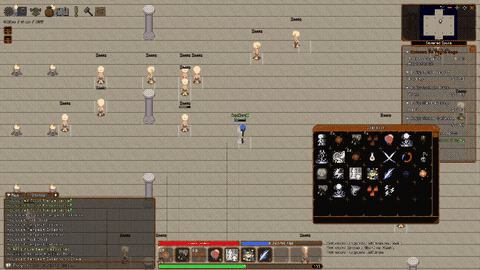
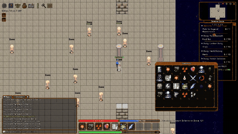
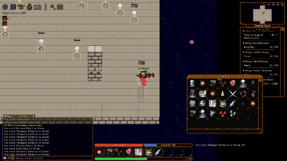
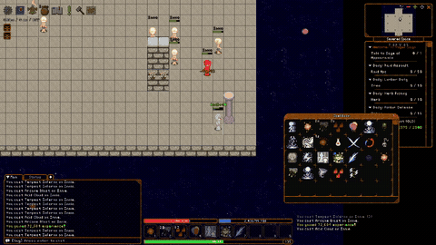
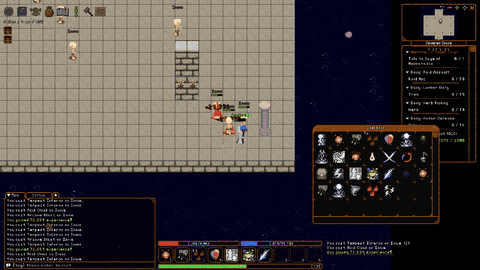
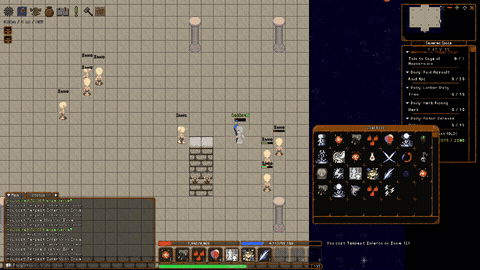
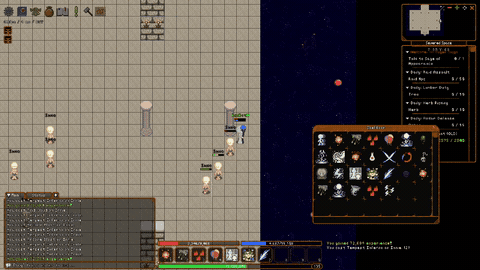
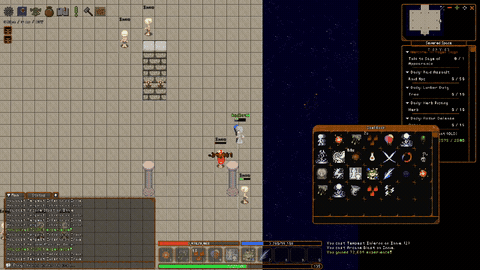
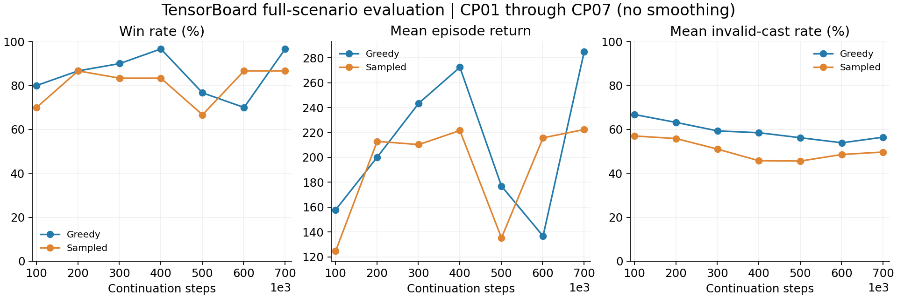
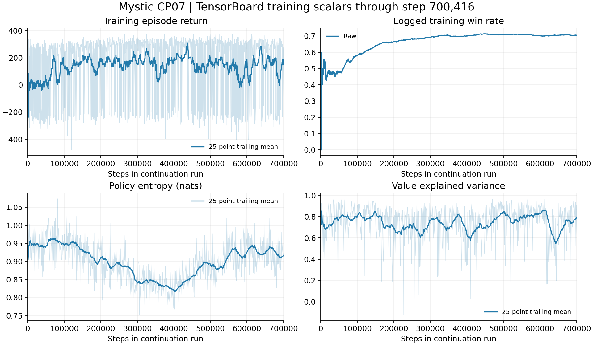

# RL Decision Server

A bridge between a reinforcement learning agent and the Yugen Saga game. The project connects the browser game to Python RL training code through a WebSocket-to-ZMQ bridge, then trains or evaluates agents with custom Gymnasium environments.

## Mystic CP07: simulator policy running live

The simulator-trained Mystic attention/LSTM policy has been run successfully on
live Yugen Saga servers, as reported by the operator and demonstrated in the
recording below. Live inference loads the frozen actor; it does not train weights.

### Live gameplay clips

The supplied 70.7-second recording is split chronologically into eight small,
looping GIFs (480 px wide, 6 fps, each under 3 MB). They cover the complete video;
the original MP4 remains local at `runs/rl yugen.mp4`.

| 0-9 seconds | 9-18 seconds |
| --- | --- |
|  |  |

<details>
<summary>More live clips: 18-70.7 seconds</summary>

| 18-27 seconds | 27-36 seconds |
| --- | --- |
|  |  |

| 36-45 seconds | 45-54 seconds |
| --- | --- |
|  |  |

| 54-63 seconds | 63-70.7 seconds |
| --- | --- |
|  |  |

</details>

The operator identifies the demonstrated checkpoint as CP07. The video does not
establish its hash, action-selection mode, or a measured live win rate.
[Clip timestamps and sizes](Sample_Runs/Mystic_CP07/clips.json) are retained;
[export_clips.py](Sample_Runs/Mystic_CP07/export_clips.py) reproduces the splits
from the original recording with `imageio-ffmpeg` installed.

### Current algorithm: cross-attention LSTM PPO

The current Mystic model is recurrent **Proximal Policy Optimization (PPO)**,
trained in the headless simulator. Its 80-value observation contains player
state, up to ten enemies, local enemy offsets, action history and terrain sensors.
A four-head cross-attention encoder uses the player as a query over enemy keys
and values, masking empty/dead enemy slots. Its 64-value enemy summary is combined
with player, history and terrain features, then passed through a feedforward
encoder and a 128-unit LSTM to retain context across decisions.

Actor and critic have separate encoders and recurrent states. PPO trains the
actor with a clipped policy objective and the critic to predict returns. The
actor outputs seven action probabilities: four movement directions and three
spells. Deployment loads only the frozen actor's decision path and carries its
LSTM memory between live snapshots; sampled or greedy selection determines the
action sent through the existing bridge. See the [attention encoder](Training/Mystic_Sim/Attention.py),
[recurrent model](Training/Mystic_Sim/recurrent.py), and [training loop](Training/Mystic_Sim/train.py).

### Run the checkpoint on the live server

Install the project dependencies using the [installation guide](InstallationReadMe.md).
Use CUDA-enabled PyTorch for GPU inference, or choose `-Device cpu`.
Pull the latest JS plugin, reload it in `chrome://extensions`, and refresh the
game tab so its updated page script and service worker are both active.
The supported map is **map53**. Start with a living player and spell cooldowns
ready, then run from the repository root:

```powershell
$Checkpoint = "runs\mystic_sim\full\attention_cp09_continue_1m_lr1e4_seed42\checkpoints\checkpoint_07.pt"
.\RunInference.ps1 -Checkpoint $Checkpoint -AssumeSimParity -ActionMode sampled -Device cuda
```

Enable the plugin's AI loop in the game. The launcher waits for actor readiness,
starts the WebSocket/ZMQ bridge automatically, and prints
`Live snapshots accepted; policy actions are flowing.` when commands begin.
There is no need to launch a second bridge manually.

| Option | Behavior |
| --- | --- |
| `-Checkpoint "path.pt"` | Required explicit checkpoint selection for this route; weights are not bundled with the README |
| `-ActionMode sampled` | Default: sample from the actor's action probabilities |
| `-ActionMode greedy` | Choose the highest-probability action |
| `-Device cuda` | Default: run on the GPU; `cuda:1` selects another GPU |
| `-Device cpu` | Run without CUDA |
| `-AssumeSimParity` | Reuse simulator rules to estimate history for the existing 80-input checkpoint |

For greedy CPU inference using the same checkpoint:

```powershell
.\RunInference.ps1 -Checkpoint $Checkpoint -AssumeSimParity -ActionMode greedy -Device cpu
```

The parity mode uses live player/enemy snapshots, shared map terrain sensors,
and simulator rules to track estimated cooldowns, blocked movement and cast
history. These are predictions under the simulator/game parity assumption,
not confirmed server outcomes. See [history details](Inference/Mystic_Live/SIMULATED_FEEDBACK.md).

Stop with Ctrl+C. Death, disconnect, an unsupported map, or a timeout also ends
the run; the launcher cleans up its processes. Restart the launcher and AI loop
for another run. Logs are saved under `logs/`; final state, chosen commands and
history diagnostics are saved under `runs/mystic_live/run_*/final_state.json`.

| Startup message | Action |
| --- | --- |
| `extension_update_required` | Pull the latest JS plugin, reload the extension, then refresh the game tab |
| `unsupported_map` | Move to map53 and restart inference and the AI loop |
| `No live snapshots received` | Check the plugin connection to `ws://127.0.0.1:8765` and enable its AI loop |
| CUDA unavailable | Install a compatible CUDA PyTorch build or use `-Device cpu` |

### CP07 results

Checkpoint: `attention_cp09_continue_1m_lr1e4_seed42/checkpoints/checkpoint_07.pt`.
It was saved at **700,416 continuation steps** (**7,901,184 cumulative steps**).
The table uses the saved full-scenario simulator evaluations, each with 30
episodes on seeds 20000-20029. These are simulator results; the live video is a
separate demonstration of deployment.

| Simulator metric | Greedy | Sampled |
| --- | ---: | ---: |
| Wins | 29 / 30 | 26 / 30 |
| Win rate | 96.7% | 86.7% |
| Mean episode return | 285.03 | 222.37 |
| Mean kills | 4.87 | 4.50 |
| Mean episode duration | 102.57 s | 95.37 s |
| Mean invalid-cast rate | 56.49% | 49.69% |

Greedy performed better on wins and return in this saved evaluation. Sampled
remains the launch default by operator choice. Invalid casts include rejected
attempts such as cooldown rejection; the policy is not error-free.

### TensorBoard results

The original event files include full-scenario evaluations at CP01 through CP07.
These curves use `evaluation_full/{greedy,sampled}/` scalars directly, without
smoothing. Each point represents a saved checkpoint evaluation; CP07 is the
rightmost point and agrees with the table above.



[Raw evaluation scalars](Sample_Runs/Mystic_CP07/evaluation_scalars.csv) are
included for inspection. These are charts exported from TensorBoard event data,
not screenshots of the TensorBoard web interface.

The following charts are exported from the run's actual TensorBoard scalar
records, **ending at CP07**. They do not include CP08-CP10. Faint lines show raw
values; the return, entropy and explained-variance overlays use a 25-point
trailing mean. The win-rate panel shows cumulative training wins divided by episodes, without
extra smoothing; it differs from the separate checkpoint evaluation win rates.
The horizontal axis counts steps within this continuation run, not lifetime steps.



[Metric sources, checkpoint SHA-256 and evaluation summaries](Sample_Runs/Mystic_CP07/results.json)
- [Raw chart scalars (CSV)](Sample_Runs/Mystic_CP07/training_scalars.csv)
- [Chart export script](Sample_Runs/Mystic_CP07/export_assets.py)

To inspect the original interactive TensorBoard logs locally:

```powershell
.\RL_venv\Scripts\python.exe -m tensorboard.main --logdir "runs\mystic_sim\full\attention_cp09_continue_1m_lr1e4_seed42\tensorboard" --port 6006
```

Open `http://localhost:6006`. The original log directory includes later
checkpoints; use step 700416 as the CP07 cutoff. Rebuild the README charts with
`.\RL_venv\Scripts\python.exe Sample_Runs/Mystic_CP07/export_assets.py`
(requires the original local run, `matplotlib`, and `tensorboard`).

## Current project layout

| Location | Purpose |
| --- | --- |
| `Custom_enviornments/Mystic_Sim/` | Headless simulator, maps, observations, actions and optional Pygame viewer |
| `Training/Mystic_Sim/Attention.py` | Player-query cross-attention over visible enemies |
| `Training/Mystic_Sim/recurrent.py` | Separate actor/critic LSTMs and recurrent PPO sequence handling |
| `Training/Mystic_Sim/train.py` | Simulator training, checkpointing and evaluation logging |
| `Inference/Mystic_Live/` | Checkpoint loading, shared inputs, history estimates and live command lifecycle |
| `Automation/Bridge/ws_zmq_bridge.py` | Browser WebSocket to Python ZMQ transport |
| `RunInference.ps1` | Automated actor and bridge launch, logging and cleanup |
| `Sample_Runs/Mystic_CP07/` | Live GIF clips, TensorBoard charts, source data and export scripts |

To play the simulator locally, use `Play_Mystic_Sim.bat` after installing
`requirements-viewer.txt`. See the [simulator guide](Custom_enviornments/Mystic_Sim/README.md)
for its controls and environment details.

Earlier direct-live training, DQN, recording, BC and AWAC instructions are
preserved in [Legacy workflows](LEGACY_WORKFLOWS.md). They are separate from the
current simulator-to-live checkpoint workflow above.
